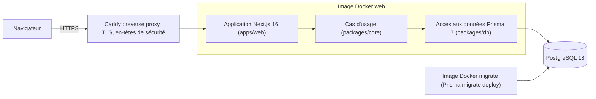

# Architecture technique

Version du 2026-11-11 (fin de la phase 0). Ce document décrit l'architecture du prototype, ses règles et sa trajectoire de montée en charge. L'infrastructure de déploiement est détaillée dans docs/DEPLOIEMENT.md.

## 1. Vue d'ensemble

Le prototype est un monolithe modulaire (DEC-006) : une seule application Next.js déployée, mais une logique métier isolée dans un package indépendant du framework.

## 2. Organisation du dépôt

| Dossier | Rôle | Dépend de |
|---|---|---|
| apps/web | Interface (pages, composants) et adaptateurs HTTP : Server Actions, Route Handlers | packages/core, packages/db |
| packages/core | Cas d'usage métier en TypeScript pur (santé, catalogue, puis panier, commandes, comptes) | packages/db |
| packages/db | Schéma Prisma, migrations versionnées, client et pool de connexions | (aucun package interne) |
| e2e | Tests de bout en bout Playwright et audit axe | l'application en fonctionnement |
| ops | Provisionnement du serveur, déploiement, configuration Caddy | |

Outils transverses : pnpm 11 (espaces de travail), TypeScript strict, ESLint, Prettier, Vitest, Playwright, dependency-cruiser.

## 3. Règles d'architecture

1. **Le métier ne dépend pas du framework.** packages/core n'importe jamais `next`, `react` ni `react-dom`. Cette règle est vérifiée par dependency-cruiser (`pnpm check:boundaries`) et bloque la CI. Elle garantit qu'une API séparée peut être extraite sans réécrire de logique.
2. **Les dépendances pointent vers l'intérieur.** Les applications dépendent des packages, jamais l'inverse ; packages/db n'importe pas packages/core. Les cycles sont interdits.
3. **Des adaptateurs minces.** Chaque cas d'usage est une fonction de packages/core. Une Server Action (formulaires du site) ou un Route Handler (`/api/...`) se contente de lire l'entrée, d'appeler le cas d'usage et de formater la réponse. Aucune logique n'est codée deux fois.
4. **Une route REST seulement pour un consommateur réel.** Un handler `/api/v1/*` est ajouté pour un webhook (Stripe), un test d'intégration HTTP ou la future application mobile, pas par principe.
5. **Les dépendances sont injectées.** Les cas d'usage reçoivent le client de base de données en paramètre (`listCollections(db)`), ce qui permet de les tester sur une base réelle jetable ou avec un double.
6. **Les erreurs internes ne fuient pas.** Par exemple, `/api/health` indique l'état de chaque composant sans exposer le message d'erreur ni la chaîne de connexion.

## 4. Flux d'une requête (exemple de la page d'accueil)

1. Caddy termine le TLS, ajoute les en-têtes de sécurité et transmet la requête au conteneur web.
2. Le composant serveur `apps/web/src/app/page.tsx` appelle `listCollections(getPrisma())`.
3. Le cas d'usage interroge PostgreSQL via le client Prisma partagé (un pool de connexions par processus).
4. Le HTML est rendu côté serveur (SEO, NF-08) et renvoyé au navigateur.

## 5. Données

- Schéma déclaratif : packages/db/prisma/schema.prisma. Chaque évolution produit une migration SQL versionnée, relue et rejouée en CI (base de test) puis au déploiement (image migrate).
- Données de référence (les trois gammes) livrées par une migration idempotente, présentes dans tous les environnements.
- Les migrations sont pensées pour être compatibles avec la version précédente de l'application (ajout avant suppression), ce qui permet le retour arrière de l'image sans retour arrière du schéma.
- Modèle cible : voir docs/SPECS.md §6.

## 6. Qualités visées et moyens

| Exigence | Moyen |
|---|---|
| NF-03 Sécurité | En-têtes ajoutés par Caddy (HSTS, nosniff, X-Frame-Options, Referrer-Policy, Permissions-Policy), conteneurs non root, réseau de la base isolé d'internet, secrets hors dépôt, audit des dépendances en CI |
| NF-05 Scalabilité | Application sans état, configuration par variables d'environnement, un pool de connexions par instance |
| NF-06 Qualité | TypeScript strict, lint, frontière vérifiée, couverture de packages/core de 80 % au moins |
| NF-07 Observabilité | `/api/health` (état de la base, latence), healthchecks Docker |
| NF-12 Identité visuelle | Couleurs de la charte en variables CSS centralisées (`apps/web/src/app/globals.css`) |

## 7. Montée en charge

L'application ne garde aucun état en mémoire entre deux requêtes : plusieurs instances peuvent tourner côte à côte.

1. Serveur plus gros (changement de gamme chez l'hébergeur).
2. Base de données séparée, puis base managée (PostgreSQL managé chez l'hébergeur retenu).
3. Plusieurs instances de l'image web derrière un répartiteur de charge, médias sur un stockage objet avec CDN, cache HTTP.
4. Réplique de lecture de la base, file d'attente pour les envois de courriels.

## 8. Chemin d'extraction d'une API (si l'application mobile se concrétise)

1. Créer apps/api (Fastify) qui importe packages/core.
2. Y déplacer les handlers `/api/v1/*` existants : ce ne sont que des adaptateurs, aucune logique métier n'est réécrite.
3. Ajouter une authentification par jeton pour le mobile.
4. Router `/api` vers ce nouveau service dans Caddy.

La règle de frontière de packages/core est ce qui rend cette extraction peu coûteuse.
