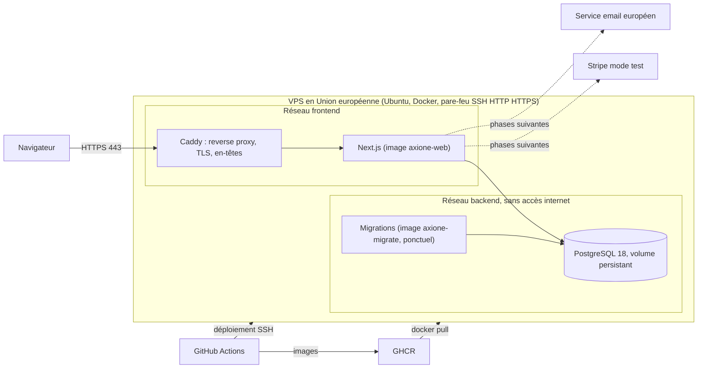

# Déploiement, CI/CD et coûts

Statut au 2026-11-11 : mode de déploiement, environnements et hébergeur cible tranchés (DEC-012 à DEC-014). Supervision, sauvegardes et nom de domaine restent à trancher (DEC-022, DEC-023). Les prix ont été relevés en novembre 2026 sur des pages d'hébergeurs et des comparateurs tiers. Ils changent souvent : les confirmer sur le site de l'hébergeur avant de les citer au jury.

## 1. Principes

- Hébergement dans l'Union européenne (DEC-004), pour la défense RGPD.
- Docker Compose sur un VPS, derrière Caddy (reverse proxy et TLS automatique). Deux images construites une seule fois par la CI et déployées telles quelles : `axione-web` (application) et `axione-migrate` (migrations Prisma, exécutées une fois avant chaque démarrage de l'application).
- Aucun secret dans le dépôt : variables dans les environnements GitHub et dans un fichier d'environnement sur le serveur.
- Déploiement reproductible par scripts (ops/), retour arrière automatique vers l'image précédente si le déploiement échoue.
- Mode "à la demande" jusqu'en mars : aucun serveur permanent avant la préparation de la soutenance. La CI prouve la déployabilité à chaque fusion dans main en lançant la pile complète sur son runner. Un VPS réel n'est loué que pour des essais ponctuels (fin de phase 0, fin de phase 2, février), puis pour la démonstration.
- Scripts d'infrastructure génériques (Ubuntu et Docker, aucune API propre à un hébergeur) : changer d'hébergeur revient à relancer le provisionnement ailleurs.
- Budget cible pour la démonstration de mars : au plus 30 € par mois. Pour le jury, aucun nom de domaine n'est nécessaire.

## 2. Environnements (DEC-014)

| Environnement | Rôle | Où | Déclencheur |
|---|---|---|---|
| Local | Développement | Poste du développeur : `compose.dev.yaml` (PostgreSQL), `pnpm dev` | Manuel |
| CI | Lint, types, tests unitaires et d'intégration sur base jetable | Runner GitHub Actions | Chaque pull request et chaque push sur main |
| Staging éphémère | Pile complète construite à partir des images publiées : e2e, axe, Lighthouse | Runner GitHub Actions, détruite à la fin du job | Chaque fusion dans main |
| Staging réel | Recette sur un vrai serveur, démonstration | VPS, à partir de février | Workflow Deploy manuel |
| Production | Version présentée comme "en ligne" | Même VPS que le staging réel, à partir de février | Workflow Deploy manuel, avec approbation (environnement GitHub protégé) |

Staging et production sur le même serveur : deux piles Compose isolées (nom de projet, réseaux, volumes et bases distincts). Point à régler en février : un seul Caddy partagé devra router les deux noms d'hôte, car deux piles ne peuvent pas publier toutes deux les ports 80 et 443.

## 3. Pipeline CI/CD (GitHub Actions)

| Workflow | Déclencheur | Étapes |
|---|---|---|
| `.github/workflows/ci.yml` | Pull request, push sur main | Installation avec cache, génération du client Prisma, lint, formatage, types, frontière d'architecture, tests unitaires et d'intégration (service PostgreSQL 18) avec seuil de couverture, build, audit des dépendances, analyse SonarQube Cloud (quality gate sur le code nouveau) |
| `.github/workflows/main.yml` | Push sur main | Construction des images web et migrate, publication dans GHCR (tag = SHA du commit), puis staging éphémère : pile complète lancée avec ces images, migrations, e2e Playwright, audit axe, Lighthouse CI, rapports en artefacts |
| `.github/workflows/deploy.yml` | Manuel (environnement et tag choisis) | Copie des fichiers de déploiement par SSH, connexion du serveur au registre avec le jeton éphémère du job, `ops/deploy.sh` (pull, migrations, démarrage, test de santé, retour arrière automatique en cas d'échec) |

Cible : moins de 8 minutes pour le workflow CI (NF-10). Turborepo n'est ajouté que si cette cible est dépassée (DEC-009).

À venir : sauvegarde nocturne de la base vers un stockage objet et veille sur les dépendances (DEC-022).

## 4. Alternatives à la CI GitHub Actions (à citer dans le dossier)

- Jenkins : puissant, mais serveur à héberger, sécuriser et maintenir, sans bénéfice pour un projet solo.
- GitLab CI : excellent outil, mais imposerait de migrer ou de refléter le dépôt ailleurs.
- CircleCI : service tiers supplémentaire sans avantage décisif ici.
Choix : GitHub Actions (DEC-003 validée), car le code est déjà sur GitHub et qu'aucun serveur de CI n'est à maintenir.

## 5. Schéma d'infrastructure

L'application est une seule image Next.js (architecture décrite dans docs/ARCHITECTURE.md). Seul Caddy publie des ports ; la base n'est joignable que depuis le réseau interne. Docker contournant les règles UFW pour les ports publiés, aucun autre conteneur ne doit publier de port.

## 6. Hébergeurs européens comparés (relevés novembre 2026, DEC-013)

Critère retenu : le coût réel d'exploitation pour une entreprise, au mois et à l'année, renouvellement compris, pour un VPS d'environ 8 Go accueillant staging et production.

| Hébergeur | Pays | Offre | Ressources | Prix relevé (HT) | Coût annuel estimé | À savoir |
|---|---|---|---|---|---|---|
| OVHcloud (cible provisoire) | France | VPS-2 | 4 vCore, 8 Go, 75 Go NVMe | Environ 7,2 € par mois avec engagement de 12 mois, de 8,5 à 10 € sans engagement selon la gamme | Environ 87 à 120 € | Anti-DDoS inclus, stockage objet S3, PostgreSQL managé et répartiteur disponibles pour la montée en charge. Hausse de prix au printemps 2026, grilles 2026 et 2027 qui se chevauchent, support jugé inégal |
| Hetzner | Allemagne, Finlande | CX33 | 4 vCPU, 8 Go, 80 Go | 8,99 € par mois IPv4 compris (hausse de 31 % en juin 2026), sauvegardes plus 20 % | Environ 108 € | Très bon rapport prix et performance, pas de base managée, gamme CX signalée indisponible à la commande à l'automne 2026 |
| Hostinger | Lituanie (siège) | KVM 2 | 2 vCPU, 8 Go, 100 Go | 8,99 $ par mois prépayés sur 24 mois, puis 14,99 $ au renouvellement | Environ 180 $ après la première période | Prix d'appel qui doublent, facturation en dollars, emplacement UE à vérifier, envoi de courriels limité |
| Scaleway | France | DEV1-L | 4 vCPU, 8 Go | Environ 31 € par mois | Environ 375 € | Écosystème cloud le plus riche, au-dessus du budget |

Choix provisoire : OVHcloud VPS-2, comparaison refaite en février avec les grilles officielles du moment.

## 7. Nom de domaine

Nom suggéré pour le dossier : axione.fr (fictif). Un .fr coûte environ 5 à 7 € HT la première année puis 6,6 à 8 € HT par an selon le registrar (OVHcloud : 4,99 puis 7,79 € HT. BookMyName : 5,98 puis 6,59 € HT), soit moins de 1 € par mois. L'enregistrement d'un .fr demande des informations d'identité (particulier ou entreprise). TLS gratuit avec Let's Encrypt via le reverse proxy.

## 8. Estimations de coût

Les lignes marquées "estimation" ne sont pas sourcées et doivent être confirmées avant d'être publiées dans le dossier.

### Scénario A : démonstration au jury (mars 2027)
| Poste | Mensuel |
|---|---|
| Novembre à janvier : aucun serveur permanent (staging éphémère en CI) | 0 € |
| Essais ponctuels sur un VPS (fin de phase 0, fin de phase 2), environ un mois sans engagement chacun | Environ 9 € par essai |
| À partir de février : VPS UE de 4 vCore et 8 Go (staging et production) | Environ 7,2 à 10 € |
| Sauvegardes et stockage objet | À chiffrer avec DEC-022 |
| Domaine (optionnel) | Environ 0,6 € |
| GitHub Actions, GHCR, SonarQube Cloud, Stripe en mode test | 0 € dans les quotas gratuits |
| Total en régime de démonstration | Environ 8 à 11 € par mois |

### Scénario B : lancement réel d'Axione (projection pour le dossier)
| Poste | Mensuel (estimation) |
|---|---|
| VPS de production de 8 Go | De 7 à 9 € |
| VPS ou pile de staging | De 4,5 à 7 € |
| Stockage objet et sauvegardes de la base | De 3 à 6 € |
| Emails transactionnels et newsletter | De 0 € (offre gratuite) à 15 € |
| Analytics sans cookie | De 0 € (auto-hébergé) à 10 € |
| Supervision (disponibilité, erreurs) | De 0 à 10 € |
| Domaine | Environ 0,6 € |
| Total | Environ 25 à 55 € HT, hors frais Stripe |
Frais de paiement Stripe : proportionnels au montant plus un montant fixe par transaction, à relever sur stripe.com. Ils ne dépendent pas de l'hébergeur.

### Scénario C : montée en charge (argument d'évolutivité)
1. Mise à l'échelle verticale : passer à un serveur plus gros (changement de gamme chez l'hébergeur).
2. Séparer l'application et la base sur des serveurs distincts, avec une base managée (offre à vérifier chez l'hébergeur retenu).
3. Plusieurs instances de l'application derrière un répartiteur de charge (environ 5,4 à 6 € par mois chez Hetzner), cache HTTP et CDN pour les médias.
4. Réplique de lecture de la base, files d'attente pour les emails.
5. Orchestration de conteneurs seulement si l'équipe et le trafic le justifient (hors périmètre du prototype, à citer comme horizon).
Cela est possible parce que l'application est sans état (NF-05) et que les médias sont hors du serveur applicatif.

## 9. Sauvegardes, supervision, reprise

- Sauvegarde nocturne de la base (dump chiffré) vers un stockage objet en UE, rotation de 7 à 30 jours, test de restauration documenté.
- Endpoint `/health`, supervision de disponibilité et suivi d'erreurs (DEC-022).
- Reprise après sinistre : un serveur neuf se reconstruit avec `ops/provision.sh`, les images viennent du registre, la base se restaure depuis le dernier dump.
- Durée de reconstruction mesurée à chaque location d'un VPS :

| Date | Hébergeur | Étapes | Durée | Remarques |
|---|---|---|---|---|
| (premier essai en fin de phase 0) | | | | |

## 10. À vérifier avant la soutenance

- Prix et localisations de l'hébergeur retenu, à la date de la rédaction du dossier.
- Quota gratuit de minutes GitHub Actions sur dépôt privé, et conditions des outils gratuits de qualité de code pour dépôt public.
- Frais Stripe et conditions du plan gratuit du service d'email retenu.
