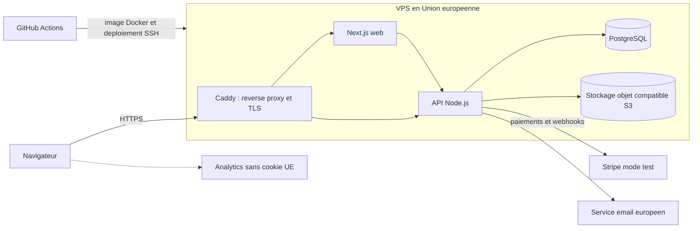

# Déploiement, CI/CD et coûts

Statut : proposition de départ. Rien ici n'est validé tant que la décision correspondante n'est pas marquée "Validée" dans DECISION.md (DEC-012 à DEC-014, DEC-022, DEC-023). Les prix ont été relevés en novembre 2026 sur des pages d'hébergeurs et des comparateurs tiers. Ils changent souvent : les confirmer sur le site de l'hébergeur avant de les citer au jury.

## 1. Principes

- Hébergement dans l'Union européenne (DEC-004 validée), pour la défense RGPD.
- Une image Docker construite une seule fois par la CI, puis déployée telle quelle sur chaque environnement.
- Aucun secret dans le dépôt : variables dans les environnements GitHub et sur le serveur.
- Déploiement reproductible par scripts (ops), retour arrière possible en redéployant l'image précédente.
- Budget cible pour la démo de mars : au plus 30 € par mois. Pour le jury, aucun nom de domaine n'est nécessaire.

## 2. Environnements proposés (DEC-014 à valider)

| Environnement | Rôle | Déclencheur |
|---|---|---|
| Local | Développement | Docker Compose |
| CI | Tests automatisés sur base jetable | Chaque push et pull request |
| Staging | Recette, tests e2e, accessibilité, démonstration au jury | Fusion dans main |
| Production | Version présentée comme "en ligne" | Tag de version ou validation manuelle |

Montrer qu'on déploie d'abord sur staging, puis seulement après vérification sur production, est un bon argument de maturité pour le jury. Pour un budget minimal, staging et production peuvent partager un même serveur (deux piles Docker Compose isolées).

## 3. Pipeline CI/CD (GitHub Actions)

1. Pull request : installation avec cache, lint, typecheck, tests unitaires et d'intégration (base PostgreSQL de test en service), build, audit des dépendances, envoi de la couverture, analyse de qualité (DEC-011).
2. Fusion dans main : construction des images, publication dans le registre de GitHub (GHCR), migrations de base, déploiement sur staging, tests e2e Playwright, contrôles axe et Lighthouse sur staging.
3. Production : déclenchée par un tag ou une approbation manuelle (environnement GitHub protégé), même image que staging, test de fumée, retour arrière par redéploiement du tag précédent.
4. Planifié : sauvegarde nocturne de la base vers un stockage objet, veille sur les dépendances.

Cible : moins de 8 minutes pour les étapes de la pull request.

## 4. Alternatives à la CI GitHub Actions (à citer dans le dossier)

- Jenkins : puissant, mais serveur à héberger, sécuriser et maintenir, sans bénéfice pour un projet solo.
- GitLab CI : excellent outil, mais imposerait de migrer ou de refléter le dépôt ailleurs.
- CircleCI : service tiers supplémentaire sans avantage décisif ici.
Choix : GitHub Actions (DEC-003 validée), car le code est déjà sur GitHub et qu'aucun serveur de CI n'est à maintenir.

## 5. Schéma d'infrastructure (proposition)

L'architecture exacte dépend de DEC-006 (une application Next.js seule, ou Next.js plus API Node séparée).

## 6. Hébergeurs européens comparés (relevés novembre 2026)

| Hébergeur | Pays | Offre relevée | Ressources | Prix mensuel relevé | À savoir |
|---|---|---|---|---|---|
| OVHcloud | France | VPS-2 | 4 vCore, 8 Go, 75 Go NVMe | 8,49 € (VPS-1 : 2 vCore, 4 Go, 4,49 €) | Hausse de prix rapportée en mars 2026 sur la gamme VPS. Support jugé inégal par les avis. Les prix varient selon les sources et la région |
| Hetzner | Allemagne, Finlande | CX33 | 4 vCPU, 8 Go, 80 Go | 6,49 € HT plus 0,50 € pour l'IPv4. Sauvegardes : plus 20 % | Facturation à l'heure, 20 To de trafic inclus. Plusieurs sources signalent des hausses en 2026 et des problèmes de disponibilité des plans CX : vérifier avant de choisir |
| Scaleway | France | DEV1-M (3 vCPU, 4 Go) environ 14 €. DEV1-L (4 vCPU, 8 Go) environ 30 € | Gamme DEV1, à comparer aux gammes plus récentes | De 14 à 30 € | Facturation à l'heure, forte image "cloud français", plus cher à ressources égales |
| Hostinger | Lituanie (siège) | KVM 2 | 2 vCPU, 8 Go, 100 Go NVMe | De 6,29 à 8,99 $ avec engagement de 24 mois, environ 15 $ au renouvellement, 24,49 $ sans engagement | Prix d'appel qui doublent au renouvellement. Envoi d'emails sortants limité par serveur : prévoir un service d'email externe. Emplacements des datacenters à vérifier |
| Vercel (plan B pour la démo) | États-Unis, régions UE disponibles | Pro | Service managé pour Next.js | 20 $ par utilisateur et par mois. Le plan gratuit Hobby est réservé à un usage personnel non commercial | Très simple, mais hébergeur hors UE : argument RGPD plus faible, moins de contrôle, hors du budget pour un site marchand |

Lecture : pour une démonstration, un VPS de 4 vCPU et 8 Go chez un hébergeur de l'UE suffit largement et coûte entre 6,5 et 8,5 € par mois. La comparaison utile pour le jury porte sur le prix, la localisation des données, le support, l'écosystème (stockage objet, bases managées) et le temps d'exploitation que cela représente pour une seule personne.

## 7. Nom de domaine

Nom suggéré pour le dossier : axione.fr (fictif). Un .fr coûte environ 5 à 7 € HT la première année puis 6,6 à 8 € HT par an selon le registrar (OVHcloud : 4,99 puis 7,79 € HT. BookMyName : 5,98 puis 6,59 € HT), soit moins de 1 € par mois. L'enregistrement d'un .fr demande des informations d'identité (particulier ou entreprise). TLS gratuit avec Let's Encrypt via le reverse proxy.

## 8. Estimations de coût

Les lignes marquées "estimation" ne sont pas sourcées et doivent être confirmées avant d'être publiées dans le dossier.

### Scénario A : démonstration au jury (mars 2027)
| Poste | Mensuel |
|---|---|
| VPS UE de 4 vCPU et 8 Go (staging et production sur le même serveur) | De 6,5 à 8,5 € |
| Sauvegardes du serveur | Environ 1,3 à 1,7 € (20 % chez Hetzner) |
| Domaine (optionnel) | Environ 0,6 € |
| GitHub Actions, GHCR, Stripe en mode test | 0 € dans les quotas gratuits (à vérifier) |
| Total | Environ 8 à 11 € |

### Scénario B : lancement réel d'Axione (projection pour le dossier)
| Poste | Mensuel (estimation) |
|---|---|
| VPS de production de 8 Go | De 7 à 9 € |
| VPS ou pile de staging | De 4,5 à 7 € |
| Stockage objet et sauvegardes de la base | De 3 à 6 € |
| Emails transactionnels et newsletter | De 0 € (offre gratuite) à 15 € |
| Analytics sans cookie | De 0 € (auto-hébergé) à 10 € |
| Supervision (disponibilité, erreurs) | De 0 à 10 € |
| Domaine | Environ 0,6 € |
| Total | Environ 25 à 55 € HT, hors frais Stripe |
Frais de paiement Stripe : proportionnels au montant plus un montant fixe par transaction, à relever sur stripe.com. Ils ne dépendent pas de l'hébergeur.

### Scénario C : montée en charge (argument d'évolutivité)
1. Mise à l'échelle verticale : passer à un serveur plus gros (changement de gamme chez l'hébergeur).
2. Séparer le web, l'API et la base sur des serveurs distincts, avec une base managée (offre à vérifier chez l'hébergeur retenu).
3. Plusieurs instances web et API derrière un répartiteur de charge (environ 5,4 à 6 € par mois chez Hetzner), cache HTTP et CDN pour les médias.
4. Réplique de lecture de la base, files d'attente pour les emails.
5. Orchestration de conteneurs seulement si l'équipe et le trafic le justifient (hors périmètre du prototype, à citer comme horizon).
Cela est possible parce que l'API est sans état (NF-05) et que les médias sont hors du serveur applicatif.

## 9. Sauvegardes, supervision, reprise

- Sauvegarde nocturne de la base (dump chiffré) vers un stockage objet en UE, rotation de 7 à 30 jours, test de restauration documenté.
- Endpoint `/health`, supervision de disponibilité et suivi d'erreurs (DEC-022).
- Reprise après sinistre : un serveur neuf se reconstruit avec le script de provisionnement, les images viennent du registre, la base se restaure depuis le dernier dump. Objectif à documenter : durée de reconstruction.

## 10. À vérifier avant la soutenance

- Prix et localisations de l'hébergeur retenu, à la date de la rédaction du dossier.
- Quota gratuit de minutes GitHub Actions sur dépôt privé, et conditions des outils gratuits de qualité de code pour dépôt public.
- Frais Stripe et conditions du plan gratuit du service d'email retenu.
